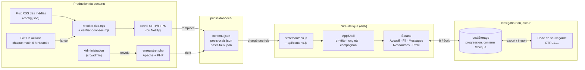
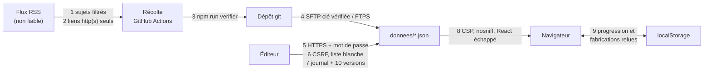

# CTRL INFO

> Seule documentation du projet. Dernière mise à jour : 27/10/2026.
> À tenir à jour à chaque changement notable (voir « Journal » en bas).

Jeu web de sensibilisation à la désinformation, pensé pour la
Nouvelle-Calédonie. Le joueur trie un fil d'actualité façon Instagram, mène des
conversations simulées et lit des fiches pour apprendre à vérifier une info.

- **Site statique** : HTML, CSS, JS, images et JSON. Pas de base de données.
- **Aucun compte, aucune donnée personnelle** : la progression reste dans le
  navigateur et s'emporte par un code à copier-coller.
- **Contenu séparé du code** : tous les textes sont dans `public/donnees/`.
- **Projet étudiant remis au commanditaire**, sans maintenance par l'équipe.
  Le fil peut se renouveler seul chaque matin (récolte RSS automatique).

## Sommaire

1. [Démarrer](#1-démarrer)
2. [Stack](#2-stack)
3. [Ce que voit le joueur](#3-ce-que-voit-le-joueur)
4. [Architecture](#4-architecture)
5. [Le contenu](#5-le-contenu)
6. [La récolte automatique](#6-la-récolte-automatique)
7. [L'administration](#7-ladministration)
8. [Mettre en ligne](#8-mettre-en-ligne)
9. [Sécurité](#9-sécurité)
10. [Limites connues](#10-limites-connues)
11. [Journal](#11-journal)
12. [Annexe : audit de sécurité](#12-annexe--audit-de-sécurité)

## 1. Démarrer

Node.js 24 requis.

| Commande | Rôle |
| --- | --- |
| `npm ci` | installe les dépendances exactes |
| `npm run dev` | serveur de développement, http://localhost:5173 |
| `npm run build` | site de production dans `dist/` |
| `npm run preview` | sert `dist/` en local |
| `npm run lint` | vérifie le code (ESLint) |
| `npm run verifier` | vérifie la forme du contenu (champs, doublons, niveaux remplis) |
| `npm run audit:securite` | rejoue les contrôles de sécurité |
| `npm run recolter` | fabrique publications et conversations depuis les flux RSS (`--essai` : n'écrit rien) |
| `node scripts/generer-sprite-cagou.mjs` | refait les planches du compagnon depuis `scripts/sprites/` |

## 2. Stack

| Rôle | Outil |
| --- | --- |
| Interface | React 19 |
| Construction | Vite 8 |
| Navigation | react-router 8 |
| Icônes | lucide-react |
| Fond animé (WebGL 2) | ogl |
| Polices | Fontsource (Archivo, Instrument Serif, Josefin Sans, Stardos Stencil) |
| Styles | CSS maison, classes BEM, sans framework |
| Récolte RSS | rss-parser, script Node lancé par GitHub Actions |
| Envoi chez l'hébergeur | lftp (SFTP ou FTPS) depuis GitHub Actions, ou Netlify |
| Enregistrement admin | `enregistrer.php` (Apache + PHP 8.1+) |
| Contrôles | ESLint, vérification du contenu, audit de sécurité, Dependabot. Pas de tests automatisés |

## 3. Ce que voit le joueur

| Adresse | Écran | Rôle |
| --- | --- | --- |
| `/` | Accueil | bannière, stories (sites où vérifier une info), tableau d'enquête, brève du jour |
| `/fil` | Fil d'actualité | le jeu principal (ci-dessous) |
| `/conversations` · `/conversations/:slug` | Messages | discussions simulées : le joueur choisit ses réponses |
| `/ressources` · `/ressources/comprendre/:slug` | Ressources | 8 thèmes à lire sur les mécanismes de la désinformation |
| `/profil` | Profil | statistiques, avatar, code de sauvegarde, réglage du compagnon |
| `/mentions-legales` | Mentions légales | éditeur, hébergeur, politique de données |

Navigation : barre en bas sur téléphone, pilule dans l'en-tête sur ordinateur
([navItems.js](src/components/navItems.js)).

**Le fil d'actualité.** Des lots de 5 publications par niveau, tirés au sort
parmi celles pas encore vues. Niveau 1 sans chrono, puis 60, 40, 30 et 25
secondes ; au-delà du niveau 5, le chrono raccourcit encore, sans jamais être
plus court que le temps de lecture. Boutons : « J'aime » et « Partager »
(= partager), « Signaler ». Laisser filer le chrono compte comme « ignorer ».
Deux erreurs sur le même biais insèrent une publication d'entraînement ciblée.
Quand tout est vu, « Continuer à jouer » fabrique de nouveaux faux dans le
navigateur, à partir des vraies déjà récoltées.

**Les conversations.** Le joueur n'écrit pas, il choisit. Chaque choix donne
une réplique du personnage (`reply`) et une explication pédagogique hors
fiction (`explication`).

**Le compagnon.** Un cagou en pixel art commente l'écran et réagit aux coups.
Il se promène dans les zones libres, ne reste jamais sur du texte, se range sur
le côté pendant une partie, et peut être déplacé à la main. Il se désactive
depuis le profil.

## 4. Architecture



Le schéma s'affiche sur GitHub ; dans VS Code, il faut l'extension
« Markdown Preview Mermaid Support ».

### Arborescence

```
index.html, admin/index.html   les deux points d'entrée (site, administration)
vite.config.js      build : renomme l'admin, injecte le .htpasswd, retire l'admin sur Netlify
config.json         flux RSS et réglages de la récolte
netlify.toml        déploiement Netlify, en-têtes de sécurité
src/
  main.jsx, App.jsx  démarrage et table des routes
  routes.js          toutes les adresses, en un seul endroit
  screens/           un fichier par écran
  components/        coque (AppShell, AppHeader, TabBar), jeux, compagnon
    ui/              briques communes (Page, Chargement, Banniere…)
  state/             état hors de React : contenu, progression, jeux, compagnon
  api/contenu.js     une fonction par collection de contenu
  lib/               utilitaires : tirage, niveaux, code de sauvegarde, fabrication…
  css/               feuilles de style, assemblées par index.css
  admin/             l'administration, formulaire déduit du contenu
public/
  donnees/           le contenu (JSON)
  admin/             enregistrer.php + .htaccess
  .htaccess          adresses et en-têtes sur Apache
scripts/             récolte, gabarits des faux, vérification, audit, sprites
.github/workflows/   recolte.yml (chaque matin), securite.yml (à chaque envoi + chaque semaine)
```

### Points à connaître

- **Le contenu est chargé une seule fois**
  ([state/contenu.js](src/state/contenu.js)). S'il manque ou est cassé,
  l'écran affiche un message clair, jamais une page blanche.
- **Chaque écran a son adresse** : lien partageable, rechargement et bouton
  « précédent » fonctionnent. L'hébergeur doit donc servir `index.html` pour
  toute adresse inconnue (voir § 8).
- **La progression** vit dans [state/progression.js](src/state/progression.js),
  écrite dans `localStorage` à chaque action. Le code de sauvegarde
  ([lib/codeProgression.js](src/lib/codeProgression.js)) a la forme
  `CTRL1.z.<données>.<empreinte>`. Il est compressé, limité à 10 000
  caractères et relu champ par champ à l'import.
- **Le tirage** ([lib/tirage.js](src/lib/tirage.js)) sert d'abord les
  inédites du niveau, puis les plus anciennes déjà vues : le fil ne s'arrête
  jamais.
- **Les styles** : couleurs, polices et tailles uniquement dans
  [css/jetons.css](src/css/jetons.css) ; éléments communs dans
  [css/motifs.css](src/css/motifs.css). L'ordre des `@import` de `index.css`
  compte.

### Ce qui est gardé dans le navigateur

| Clé / module | Contenu | Durée |
| --- | --- | --- |
| `progression.js` | niveau, publications traitées, points, biais, conversations | permanent |
| `ctrl-info:generes` | publications et conversations fabriquées sur l'appareil | permanent |
| `premiereFois.js` | stories vues, règles lues, brève du jour | permanent |
| `compagnon.js`, `compagnonVisible.js` | place et affichage du compagnon | permanent |
| `conversationSessions.js` | conversation en cours | jusqu'au rechargement |

Tous les accès à `localStorage` sont protégés : en navigation privée, le jeu
fonctionne, la progression est seulement perdue au rechargement.

## 5. Le contenu

| Fichier | Contenu |
| --- | --- |
| `posts-vrais.json` / `posts-faux.json` | les publications du fil |
| `contenu.json` → `jeux`, `niveaux` | les deux jeux, leurs tutoriels, les règles de chaque niveau |
| `contenu.json` → `remediations` | publications d'entraînement, indexées par nom de biais |
| `contenu.json` → `conversations` | les discussions et leurs choix |
| `contenu.json` → `chapitres` | les thèmes de « Ressources » |
| `contenu.json` → `ressources`, `categoriesRessources`, `stories` | les sites où vérifier une info, servis en stories |
| `contenu.json` → `astuces`, `avatars`, `mentionsLegales` | brèves du jour, avatars, mentions légales |
| `config.json` → `flux` | les médias lus par la récolte |

**Modifier** : à la main dans l'éditeur (attention aux virgules et
guillemets), ou par l'administration (§ 7). Le plus simple pour ajouter un
élément est de copier une entrée existante. Ensuite : `npm run verifier`, puis
jouer le passage modifié.

**Règles à respecter, que rien ne vérifie** :

- **Publication** : `scores[correctAction]` est le plus haut des trois scores.
  Un vrai post a un `biais` qui commence par « Aucun ». Un faux reprend
  exactement une clé de `remediations`, sinon l'entraînement ciblé ne se
  déclenche pas.
- **Conversation** : `reply` (le personnage, dans son rôle) et `explication`
  (la voix pédagogique) ne doivent jamais se ressembler.
- **Thème** : un `lien.url` en `https` est obligatoire. Le corps est une
  suite de blocs `TEXTE`, `LISTE`, `CHIFFRES` ou `CONSEIL`. Ajouter un thème ne
  demande aucun code.
- **Ressource** : sa `categorie` doit exister dans `categoriesRessources`, et
  une story doit la porter, sinon elle est inatteignable.
- **Ton** : on vouvoie le joueur. Les personnages de fiction se tutoient entre
  eux. On dit « post », « fake news » (féminin), « cagou ».

**Écrire avec une IA (facultatif)** : le site n'en utilise pas. On peut en
utiliser une à côté, pour rédiger un faux à partir d'un article réel, à
condition de le relire avant de l'ajouter dans `posts-faux.json`.

## 6. La récolte automatique

Chaque matin à 6 h (Nouméa), [recolte.yml](.github/workflows/recolte.yml) :

1. lit les flux de `config.json` ([recolter-flux.mjs](scripts/recolter-flux.mjs)) ;
2. fabrique des vraies (article repris tel quel) et des faux (article réel
   habillé par un modèle écrit à la main, [gabarits.mjs](scripts/gabarits.mjs)),
   plus quelques conversations. **Pas d'IA** : même article, même résultat ;
3. vérifie le résultat (`npm run verifier`). En cas d'échec, rien n'est
   envoyé et le site garde la version de la veille ;
4. enregistre dans le dépôt (commit `[Contenu] Récolte du …`) ;
5. envoie les trois fichiers chez l'hébergeur en SFTP/FTPS, si les secrets sont
   renseignés. Avec Netlify relié au dépôt, le site est republié de lui-même.

**Garde-fous** (rubrique `recolte` de `config.json`), puisque personne ne
relit :

- `sujetsSensibles` : sujets graves écartés ;
- `sujetsSansFaux` : sujets délicats (politique, justice…) jamais transformés
  en faux ;
- une personne nommée ne se voit rien prêter de faux, et la correction le dit ;
- `joursAvantPeremption` (45 jours), sans jamais descendre sous
  `minimumParNiveau` publications par niveau ;
- les règles sont réappliquées chaque jour au contenu déjà publié.

Les filtres reposent sur des mots-clés : ils réduisent le risque sans l'annuler.
Le commanditaire doit avoir accepté la publication sans relecture.

**Secrets GitHub** (*Settings → Secrets and variables → Actions*) :
`ENVOI_PROTOCOLE` (`sftp` conseillé, ou `ftps` ; le FTP simple est refusé),
`ENVOI_HOTE`, `ENVOI_UTILISATEUR`, `ENVOI_MOT_DE_PASSE`, `ENVOI_DOSSIER`
(le dossier `donnees` sur le serveur), et en SFTP `ENVOI_CLE_HOTE`
(sortie de `ssh-keyscan <hôte>`). Sans `ENVOI_HOTE`, rien n'est envoyé.

Lancer à la main : onglet *Actions* → « Récolte des flux » → *Run workflow*.
Arrêter : *Disable workflow*. Si la récolte s'arrête, le site continue avec le
dernier contenu reçu.

## 7. L'administration

Une page qui affiche un formulaire par collection et enregistre via
`enregistrer.php`. Sans besoin d'édition en ligne, **supprimer le dossier
d'administration de `dist/`** : c'est la meilleure protection.

- Fonctionne seulement sur **Apache + PHP** (retirée automatiquement du build
  Netlify).
- Son adresse réelle et le chemin du `.htpasswd` se règlent dans
  `config.local.json`, non versionné (modèle : `config.local.json.exemple`),
  ou via les variables `ADMIN_PATH` et `ADMIN_HTPASSWD`.
- Mot de passe : `.htpasswd` **hors du dossier public**, un compte par
  personne, 12 caractères ou plus, en bcrypt :
  `htpasswd -B -c /chemin/absolu/.htpasswd prenom`. Sans ce réglage, l'admin
  reste fermée (erreur 500).
- Chaque enregistrement est noté dans `journal.log` (jamais servi). Les 10
  dernières versions sont gardées en `.bak.<date>`.
- **Admin et récolte automatique s'excluent** : l'envoi du matin écrase les
  modifications faites en ligne. Il faut choisir l'un ou l'autre.

## 8. Mettre en ligne

1. `npm ci && npm run lint && npm run verifier && npm run audit:securite`,
   sans échec.
2. `npm run build`, puis copier le contenu de `dist/` à la racine du site, en
   SFTP ou FTPS.
3. Faire servir `index.html` pour toute adresse inconnue : déjà réglé pour
   Apache (`.htaccess`) et Netlify (`netlify.toml`). Pour Nginx :
   `try_files $uri $uri/ /index.html;`.
4. **Compléter les mentions légales** (`mentionsLegales` dans `contenu.json`).
   Les champs `[À compléter : …]` s'affichent en magenta tant qu'ils sont
   vides : éditeur et RIDET, responsable de publication, e-mail de contact,
   hébergeur, droits d'auteur.
5. Pour la récolte : transférer le dépôt GitHub sur un compte du commanditaire
   (*Settings → Transfer ownership*), puis renseigner les secrets (§ 6).
6. Vérifier en ligne : `http://` redirige vers `https://`, l'admin demande un
   mot de passe, `/donnees/contenu.json.bak` répond 403, la console du
   navigateur ne montre aucune erreur « Content-Security-Policy ».

## 9. Sécurité

**En place** : HTTPS et HSTS, en-têtes de sécurité (CSP, anti-encadrement,
`nosniff`) ; admin protégée deux fois (`.htaccess` et vérification dans le
script), contre les envois depuis un autre site, limitée à 3 fichiers et
tracée ; liens externes filtrés (`http(s)` seulement, [lib/lienWeb.js](src/lib/lienWeb.js)) ;
code de sauvegarde borné ; publications fabriquées relues au chargement et
gardées seulement si elles viennent d'un article du contenu officiel ; actions
GitHub épinglées ; workflow « Sécurité »
(lint, vérification, audit, build) à chaque envoi et chaque semaine ;
Dependabot chaque mois.

**Rien de secret dans le dépôt** : le chemin réel de l'admin
(`config.local.json`), le `.htpasswd` et les accès d'envoi (secrets GitHub)
restent dehors. Un secret apparu dans un commit, même effacé, est considéré
comme volé : il faut le changer.

**Suivi, si l'admin ou la récolte sont gardées** :

- dépôt GitHub au nom du commanditaire, double authentification pour chaque
  compte, le moins de collaborateurs possible ;
- toute modification du code passe par une *pull request* relue, workflow
  « Sécurité » au vert ;
- **chaque mois (15 min)** : pas de croix rouge dans *Actions*, propositions
  Dependabot lues, onglet *Security* vide, `journal.log` sans refus en série ni
  utilisateur inconnu ;
- **départ d'une personne** : retirer sa ligne du `.htpasswd`
  (`htpasswd -D`), changer les accès FTP/SFTP et le secret, retirer son accès
  au dépôt ;
- **chaque année** : changer les mots de passe.

**Restaurer** : versions `.bak.<date>` sur le serveur pour l'admin ; historique
git (`git revert`) pour la récolte ; le dépôt entier pour le site.

**En cas d'incident** — contenir, conserver les traces, restaurer, corriger,
informer :

| Incident | Premier geste |
| --- | --- |
| Publication choquante ou fausse | désactiver la récolte, revenir au commit précédent, ajouter le mot-clé à `sujetsSensibles` |
| Contenu modifié par un tiers | supprimer l'admin du serveur, copier les journaux, restaurer, changer **tous** les mots de passe |
| Secret ou mot de passe fuité | le changer chez l'hébergeur, puis sur GitHub, relire les journaux |
| Site blanc | ouvrir `/donnees/contenu.json` ; s'il est cassé, restaurer la dernière version saine |

**Fin de vie** : désactiver les deux workflows, supprimer les secrets `ENVOI_*`
et changer le mot de passe FTP, supprimer l'admin et `journal.log`, archiver le
dépôt. Le site statique continue de fonctionner seul.

## 10. Limites connues

- Pas de tests automatisés.
- La vérification ne porte que sur la forme du contenu : le sens se contrôle
  en jouant.
- Les filtres de la récolte reposent sur des mots-clés.
- Les images des publications sont chargées depuis les sites des médias, qui
  voient donc l'adresse IP des joueurs. À signaler dans les mentions légales.
- Pas de limite d'essais sur le mot de passe de l'admin (Basic Auth). Surveiller
  les journaux de l'hébergeur.
- Les liens externes vieilliront sans entretien.

## 11. Journal

Une ligne par changement notable, le plus récent en haut.

| Date | Changement |
| --- | --- |
| 27/10/2026 | Annexe d'audit de sécurité (§ 12) ; fabrications relues au chargement |
| 27/10/2026 | Documentation réunie dans ce seul fichier ; `docs/` supprimé |
| 27/10/2026 | Audit de sécurité, workflow « Sécurité », Dependabot |
| 27/10/2026 | Récolte sans surveillance : garde-fous, vérification, envoi SFTP/FTPS |
| 27/10/2026 | Contenu fabriqué dans le navigateur (« Continuer à jouer ») |

## 12. Annexe : audit de sécurité

Audit du 27/10/2026, selon la grille *Sécurité du code — Boloss vs Badass* et
les blocs 1 et 2 du cours (*Sécuriser un développement*, *Concevoir avant de
coder*). Résultat de `npm run audit:securite` : 38 contrôles OK, 1 alerte (le
`.htpasswd`, à régler sur le serveur), 0 échec.

### Ce qu'on protège

| Actif | Où | Menace principale |
| --- | --- | --- |
| Contenu publié | `donnees/*.json` | modification par un tiers |
| Mot de passe de l'admin | `.htpasswd` chez l'hébergeur | vol, force brute, écoute réseau |
| Accès d'envoi FTP/SFTP | secrets GitHub | fuite, écoute réseau |
| Navigateur des joueurs | le site | lien piégé ou script venu d'un flux RSS |
| Disponibilité du jeu | l'hébergement | contenu vidé ou cassé par un enregistrement |

| Action | Joueur | Éditeur (admin) | Récolte (GitHub) |
| --- | --- | --- | --- |
| Lire le contenu | ✅ | ✅ | ✅ |
| Modifier le contenu | ❌ | ✅ mot de passe + journal | ✅ commit, vérifié avant envoi |
| Fichiers modifiables | ❌ | 3, en liste blanche | `donnees/` |
| Supprimer un élément | ❌ | après confirmation, 10 versions gardées | péremption bornée par niveau |
| Fabriquer du contenu | sur son appareil seulement | ❌ | ❌ |

Un seul rôle d'édition : le projet est trop petit pour séparer « créer » et
« valider ». La trace (journal, git) et la restauration compensent.

### Flux et zones de contrôle



### Classification des données

| Donnée | Classe | Protection |
| --- | --- | --- |
| Contenu du jeu | public | intégrité : mot de passe, vérification, versions |
| Progression, pseudo, fabrications | personnel, local | ne quitte jamais le navigateur ; relu à chaque chargement |
| `journal.log` | interne | jamais servi ; IP hachée, aucun contenu |
| `.htpasswd`, secrets `ENVOI_*` | secret | hors racine web / secrets GitHub, jamais dans le dépôt |
| `config.local.json` | interne | non versionné |

**Hypothèses** : Apache + PHP 8.1+ avec HTTPS et `.htaccess` actifs (si le
`.htaccess` est ignoré, l'écriture reste refusée par le script, mais les
en-têtes manquent) ; l'éditeur est de confiance ; les flux de `config.json`
viennent de rédactions reconnues, mais leur contenu est traité comme non
fiable ; le commanditaire accepte une publication sans relecture humaine ; le
code écrit avec une IA est relu par une personne avant mise en ligne.

### Problèmes relevés et corrections

| # | Fiche | Problème | Gravité | Correction |
| --- | --- | --- | --- | --- |
| 1 | 01 | Si l'hébergeur ignore le `.htaccess`, écriture possible sans mot de passe | Haute | le script exige un utilisateur identifié (401) |
| 2 | 04 | Envoi depuis un autre site (CSRF) avec le mot de passe de l'éditeur | Haute | JSON seul, `Origin` et `Sec-Fetch-Site` vérifiés |
| 3 | 03 | HTTPS non imposé : mot de passe en clair possible | Haute | redirection HTTPS + HSTS |
| 4 | 03 | Envoi automatique en FTP simple accepté | Haute | SFTP ou FTPS seulement |
| 5 | 06 | Aucune trace des enregistrements | Moyenne | `journal.log` : date, utilisateur, fichier, résultat, IP hachée |
| 6 | 05 | Admin publiée sans mot de passe sur Netlify | Moyenne | retirée du build Netlify |
| 7 | 04 | Aucun en-tête de sécurité | Moyenne | CSP, anti-encadrement, `nosniff`, `Referrer-Policy` |
| 8 | 07 | Liens RSS non filtrés (`javascript:` possible) | Moyenne | `http(s)` seuls à la récolte, au clic et à la vérification |
| 9 | 03 | SFTP acceptait n'importe quel serveur | Moyenne | clé du serveur exigée (`ENVOI_CLE_HOTE`) |
| 10 | 10 | 8 failles connues dans les outils (7 hautes) | Moyenne | `npm audit fix` : 0 |
| 11 | 10 | Actions GitHub par étiquette, scripts d'installation actifs | Moyenne | épinglage par empreinte, `--ignore-scripts` |
| 12 | 08/10 | Aucun contrôle automatique | Moyenne | workflow « Sécurité » + Dependabot |
| 13 | Bloc 1 | Une seule sauvegarde | Moyenne | 10 versions horodatées |
| 14 | 04 | Messages d'erreur techniques renvoyés à l'éditeur | Faible | message simple, détail au journal |
| 15 | 04 | Erreur brute affichée au visiteur | Faible | message simple hors développement |
| 16 | 07 | Code de progression sans taille maximale | Faible | 10 000 caractères, 64 Ko, clés filtrées |
| 17 | 07 | Publications fabriquées relues sans contrôle | Faible | seules les entrées locales bien formées passent |
| 18 | 05 | Fichier temporaire laissé après un échec | Faible | supprimé |
| 19 | Bloc 2 | Retrait d'un élément sans confirmation | Faible | confirmation demandée |
| 20 | 01 | Chemin du `.htpasswd` à corriger à la main | Faible | injecté au build depuis `config.local.json` |
| 21 | 07 | Un lien `_blank` sans `noopener` | Faible | `noopener noreferrer` partout |

### La grille du cours

✅ appliqué · ➖ sans objet · 🔧 au déploiement.

| Fiche | Bonne pratique | État |
| --- | --- | --- |
| 01 | Utilisateurs authentifiés, actions tracées | ✅ éditeur + journal ; joueurs anonymes par conception |
| 01 | Mot de passe complexe | 🔧 12+ caractères générés, bcrypt (§ 7) |
| 01 | Message d'erreur simple | ✅ « Identification requise. » |
| 01 | Habilitations fines | ✅ joueur en lecture, éditeur limité à 3 fichiers |
| 02 | Schéma du flux | ✅ ci-dessus |
| 02 | Masquage des données sensibles | ✅ IP hachée, aucun contenu journalisé |
| 02 | Chiffrement fort | ✅ HTTPS, HSTS ; 🔧 bcrypt, jamais MD5 |
| 03 | Canaux et transit chiffrés | ✅ HTTPS, SFTP à clé vérifiée, FTPS à certificat vérifié |
| 03 | Accès applicatif limité | ✅ 3 fichiers de `donnees/` |
| 03 | Requêtes paramétrées | ➖ aucune base de données |
| 04 | Mémoire gérée | ➖ JavaScript et PHP |
| 04 | Versions récentes | ✅ `npm audit` à 0, Dependabot |
| 04 | Rejet des paramètres non prévus | ✅ liste blanche, POST et JSON seuls |
| 04 | Message d'erreur générique | ✅ visiteur et éditeur ; détail au journal |
| 05 | Aucune exposition des fichiers internes | ✅ pas de listing ; `.bak*`, `.log`, `.ht*` refusés |
| 05 | Ressources libérées | ✅ temporaire supprimé en cas d'échec |
| 05 | Utilisateur applicatif, pas root | ➖ PHP tourne sous le compte de l'hébergeur |
| 05 | Pas d'appel système externe | ✅ aucun |
| 06 | Trace de qui a fait quoi, anomalies tracées | ✅ chaque refus noté avec sa cause |
| 07 | Entrées contrôlées | ✅ admin, flux RSS, code de progression, fabrications |
| 07 | Fichiers en sortie contrôlés | ✅ `npm run verifier` bloque l'envoi |
| 07 | Référencement aléatoire | ✅ chemin d'admin secret, noms temporaires aléatoires |
| 08 | Code nettoyé, revue, audit | ✅ contrôle automatique ; 🔧 relecture humaine |
| 09 | Données de test anonymisées | ➖ aucune donnée personnelle |
| 09 | Accord du métier | 🔧 publication sans relecture acceptée par le commanditaire |
| 10 | Veille et mises à jour | ✅ Dependabot, contrôle hebdomadaire ; 🔧 alertes lues |

**Quatre piliers (bloc 1)** : confidentialité (rien de personnel côté
serveur) ; intégrité (mot de passe, CSRF, vérification, versions) ;
disponibilité (refus d'un contenu vidé, écriture atomique, la récolte garde la
veille en cas d'échec) ; traçabilité (journal, git, onglet *Actions*).

**Six principes (bloc 2)** : moindre privilège (3 fichiers, workflow en
lecture seule) ; défense en profondeur (`.htaccess` puis script, filtre RSS
puis vérification puis navigateur) ; séparation des responsabilités (➖ un
seul rôle, compensé par la trace) ; minimisation des données (aucun compte) ;
minimisation de l'exposition (admin hors Netlify, chemin secret, erreurs
simples) ; refus explicite (liste blanche, type et protocole inconnus refusés).

### Vérifications effectuées

- `enregistrer.php` sur une copie des données : sans mot de passe 401 ;
  envoi texte depuis une page piégée 415 ; autre origine 403 ;
  `Sec-Fetch-Site: cross-site` 403 ; `../../etc/passwd` 400 ; JSON cassé 400
  sans détail ; envoi légitime 200 ; 12 enregistrements → 10 versions
  gardées ; aucun fichier temporaire restant.
- Fabrications piégées dans le stockage local : 2 entrées légitimes gardées
  sur 9.
- Envoi : `ftp` → arrêt ; `sftp` sans clé de serveur → arrêt.
- Build normal, Netlify (admin retirée), avec `ADMIN_HTPASSWD` (chemin injecté)
  et avec un chemin relatif (refusé).
- Lint, vérification du contenu, `npm audit` : sans erreur.
- **Non testé** : les en-têtes dans un vrai navigateur sur Apache (§ 8,
  point 6).
