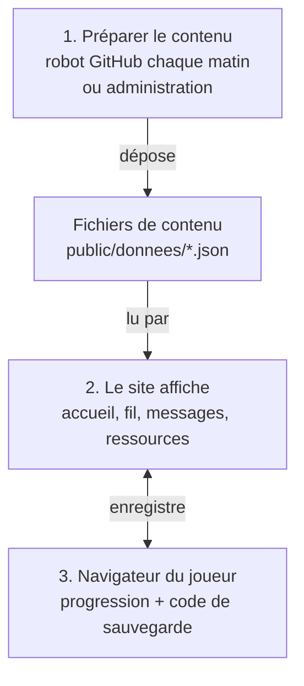

# CTRL INFO — Spécification

> Seule documentation du projet. Mise à jour : 28/10/2026.
> À modifier à chaque changement notable. L'historique est dans [JOURNAL.md](JOURNAL.md).

## 1. Le projet

Jeu web de sensibilisation à la désinformation pour la Nouvelle-Calédonie.
Le joueur trie un fil façon Instagram, répond à des messages et lit des fiches
pour apprendre à vérifier une info.

- **Site statique** : HTML, CSS, JS, images et JSON. Pas de base de données.
- **Aucun compte, aucune donnée personnelle** : la progression reste dans le
  navigateur et s'emporte par un code à copier-coller.
- **Contenu séparé du code** : tous les textes sont dans `public/donnees/`.
- **Contenu renouvelé seul chaque matin**, sans IA et sans relecture humaine.
- **Projet étudiant sans éditeur**, ni suivi ni maintenu, en ligne pour une durée limitée.

## 2. Stack

| Rôle | Outil |
| --- | --- |
| Interface | React 19, react-router 8, lucide-react |
| Construction | Vite 8, Node.js 24 |
| Styles | CSS maison (BEM), polices Fontsource, fond WebGL (ogl) |
| Génération du contenu | script Node + rss-parser, lancé par GitHub Actions |
| Envoi chez l'hébergeur | lftp (SFTP/FTPS) depuis GitHub Actions, ou Netlify |
| Administration | `enregistrer.php` (Apache + PHP 8.1+) |
| Contrôles | ESLint, `verifier`, `audit:securite`, Dependabot. Pas de tests automatisés |

## 3. Fonctionnalités

| Adresse | Écran | Contenu |
| --- | --- | --- |
| `/` | Accueil | stories (sites où vérifier une info), tableau d'enquête, brève du jour |
| `/fil` | Fil d'actualité | le jeu principal |
| `/conversations` | Messages | un fil par contact, le joueur choisit ses réponses |
| `/ressources` | Ressources | 8 thèmes sur les mécanismes de la désinformation |
| `/profil` | Profil | statistiques, avatar, code de sauvegarde, compagnon |
| `/mentions-legales` | Mentions légales | statut (sans éditeur), hébergeur, données, crédits |

**Fil d'actualité**
- Lots de 5 posts par niveau, tirés parmi les inédits.
- Niveau 1 sans chrono, puis 60, 40, 30 et 25 s. Au-delà du niveau 5, le chrono
  raccourcit encore, sans passer sous le temps de lecture.
- Boutons « J'aime » / « Partager » (= partager) et « Signaler ». Laisser
  filer le chrono = ignorer.
- Vrais et faux sont publiés par les mêmes types de comptes, avec les mêmes
  voix (ado, parent, page de quiz, alarmiste…). Seuls le fond, la source et
  le détail exact trahissent un faux.
- Un post fait quelques phrases : d'où vient l'info, une question aux abonnés,
  la source dite comme on la dit (« je l'ai vu sur Wikipédia »), jamais « Source : ».
- Les commentaires réagissent au sujet, au lieu, à la façon d'écrire du compte ;
  sous un fait déformé, celui qui a vérifié rétablit le vrai.
- Correction : une couleur par post, rouge pour une fake news, bleu pour un vrai.
- Environ un tiers d'articles : de vrais articles sous licence libre (The
  Conversation, CNIL, titre intact), et autant de faux de médias inventés.
- Deux erreurs sur le même biais insèrent un post d'entraînement ciblé.
- Quand tout est vu, « Continuer à jouer » fabrique un nouveau lot dans le
  navigateur.

**Messages** : 8 contacts. Chaque choix donne une réplique du personnage et une
explication pédagogique. « Nouveau sujet » ouvre le suivant ; quand il n'y en
a plus, le navigateur en fabrique 10.

**Compagnon** : un cagou en pixel art qui commente l'écran et réagit aux coups.
Il évite le texte, se range pendant une partie, se déplace à la main et se
désactive depuis le profil.

## 4. Architecture

Le projet tient en trois étapes.

1. **Le contenu est préparé hors du site.** Chaque matin, un robot GitHub
   fabrique de nouveaux posts à partir des faits écrits par l'équipe, les
   vérifie, puis les dépose chez l'hébergeur. Une personne peut aussi
   modifier le contenu à la main, par l'administration.
2. **Le site lit ce contenu.** Ce sont trois fichiers JSON, chargés une fois à
   l'ouverture de la page. Le site n'a pas de serveur : il ne fait qu'afficher.
3. **La progression reste chez le joueur.** Elle est gardée dans son
   navigateur. Pour changer d'appareil, il copie un code et le recolle.

Le schéma s'affiche sur GitHub ; dans VS Code, avec l'extension « Markdown
Preview Mermaid Support ».

Où se trouve chaque partie dans le code :

| Dossier / fichier | Rôle |
| --- | --- |
| `src/routes.js` | toutes les adresses |
| `src/screens/` | un fichier par écran |
| `src/components/` | coque (en-tête, onglets), jeux, compagnon |
| `src/state/` | contenu, progression, contenu fabriqué |
| `src/lib/` | tirage, niveaux, code de sauvegarde, fabrication |
| `src/css/jetons.css` | seule source des couleurs et polices |
| `src/admin/` | formulaire d'administration |
| `public/donnees/` | le contenu (JSON) |
| `public/images/` | photos libres des faits et des événements |
| `scripts/` | génération, modèles des posts, vérification, audit |
| `config.json` | réglages de la génération |
| `.github/workflows/` | `generation.yml` (chaque matin), `securite.yml` (chaque envoi et chaque semaine) |

**À savoir**
- Si le contenu manque ou est cassé, l'écran affiche un message clair.
- Chaque écran a son adresse : l'hébergeur doit servir `index.html` pour toute
  adresse inconnue.
- La progression est écrite dans `localStorage` à chaque action. Le code de
  sauvegarde est compressé, limité à 10 000 caractères et relu à l'import.
- En navigation privée, le jeu marche ; la progression est perdue au
  rechargement.

## 5. Le contenu

| Où | Quoi |
| --- | --- |
| `posts-vrais.json`, `posts-faux.json` | les posts du fil (générés) |
| `contenu.json` → `faits` | faits réels et vérifiables : version vraie, version fausse (un détail changé), source, photo |
| `contenu.json` → `scenarios` | événements inventés et anodins, avec leur `lieu` (« à La Foa ») |
| `contenu.json` → `conversations` | sujets de discussion (générés) |
| `contenu.json` → `remediations` | posts d'entraînement, un par biais |
| `contenu.json` → `chapitres`, `ressources`, `stories`, `astuces` | fiches, sites de vérification, brèves |
| `contenu.json` → `jeux`, `niveaux`, `avatars`, `mentionsLegales` | règles, tutoriels, avatars, mentions |
| `config.json` → `generation` | posts par niveau, renouvellement, médias sous licence, sujets écartés |

**Modifier** : copier une entrée existante dans le JSON (attention aux virgules),
ou passer par l'administration. Puis `npm run verifier` et jouer le passage.

**Règles**
- Un fait est vrai, sourcé (organisme public, encyclopédie), sans personne
  vivante, sans politique, coutume ni santé. Sa version fausse change un seul
  détail, sans danger si elle circulait.
- Un événement inventé ne cite aucune personne, entreprise ni institution réelle.
- Photos : libres (Wikimedia Commons), sans visage reconnaissable, avec `alt`
  et crédit, affiché sous la photo dans la correction (jamais dans le fil).
  `npm run verifier` refuse une photo sans crédit.
- Jamais de média sans licence libre ; jamais de faux tiré d'un vrai article.
- Le biais d'un faux doit exister dans `remediations`.
- Ton : on vouvoie le joueur, le cagou le tutoie, les personnages se tutoient.
  Pas de tiret cadratin. On dit « post », « fake news », « cagou ».

Ajouter des faits est le seul moyen de vraiment renouveler le jeu : le
générateur ne fait que varier leur présentation.

## 6. Génération automatique

Chaque matin à 6 h (Nouméa), `generation.yml` :

1. assemble faits, événements et articles sous licence avec des modèles écrits
   à la main (`scripts/gabarits.mjs`) ;
2. remplace les posts les plus anciens de chaque niveau, en gardant autant de
   vrais que de faux ;
3. vérifie le résultat. En cas d'échec, rien n'est envoyé : le site garde la
   version de la veille ;
4. enregistre dans le dépôt, puis envoie les 3 fichiers JSON chez l'hébergeur.

Lancer ou arrêter : onglet *Actions* → « Génération du contenu » → *Run* ou
*Disable workflow*.

**Secrets GitHub** à renseigner (*Settings → Secrets → Actions*) :
`ENVOI_PROTOCOLE` (`sftp` ou `ftps`), `ENVOI_HOTE`, `ENVOI_UTILISATEUR`,
`ENVOI_MOT_DE_PASSE`, `ENVOI_DOSSIER`, et en SFTP `ENVOI_CLE_HOTE`
(`ssh-keyscan <hôte>`). Sans `ENVOI_HOTE`, rien n'est envoyé. Seuls les noms
figurent ici : les valeurs ne s'écrivent que dans GitHub, jamais dans un
fichier, un message ou un ticket.

## 7. Administration

Formulaire d'édition du contenu en ligne. **Sans besoin d'édition, supprimer le
dossier d'administration de `dist/`.**

- Apache + PHP uniquement (retirée du build Netlify).
- **Sans adresse choisie, pas d'admin** : le build la retire si l'adresse vaut
  `admin`, `A-CHOISIR`, ou fait moins de 12 caractères.

**Mettre l'admin en ligne**

1. Copier `config.local.json.exemple` en `config.local.json` (fichier non
   versionné, à garder sur son poste).
2. Tirer une adresse au hasard et la mettre dans `admin.chemin` :
   `node -e "console.log('gestion-' + require('crypto').randomBytes(8).toString('hex'))"`
3. Créer le `.htpasswd` **sur le serveur, hors du dossier public**, un compte
   par personne, mot de passe de 12 caractères ou plus :
   `htpasswd -B -c /chemin/absolu/.htpasswd prenom`. Mettre ce chemin dans
   `admin.htpasswd`.
4. `npm run build` : le terminal affiche `administration : dist/<adresse>/`.
   Envoyer `dist/` chez l'hébergeur.
5. L'admin s'ouvre à `https://<site>/<adresse>/`. Transmettre l'adresse
   seulement aux éditeurs, de vive voix ou par gestionnaire de mots de passe.

**Changer d'adresse** (fuite, départ d'un éditeur) : nouvelle adresse dans
`config.local.json`, `npm run build`, envoi, puis **supprimer l'ancien dossier
sur le serveur**, sinon il reste en ligne. En cas de fuite, changer aussi les
mots de passe.

Sur un serveur de build sans `config.local.json`, les variables `ADMIN_PATH`
et `ADMIN_HTPASSWD` remplacent le fichier.

**À savoir**
- Chaque enregistrement est noté dans `journal.log` (date, compte, fichier,
  résultat, IP hachée avec un sel secret `.htsel`, jamais le contenu) ; au-delà
  de 1 Mo il passe en `journal.1.log`. Les 10 dernières versions sont gardées.
- **Admin et génération s'excluent** : l'envoi du matin écrase les
  modifications en ligne. Choisir l'un ou l'autre.

## 8. Mise en ligne

1. `npm ci && npm run lint && npm run verifier && npm run audit:securite`
2. `npm run build`, puis copier `dist/` chez l'hébergeur en SFTP/FTPS.
3. Servir `index.html` pour toute adresse inconnue : déjà réglé pour Apache
   et Netlify ; Nginx : `try_files $uri $uri/ /index.html;`.
4. Compléter les mentions légales : les champs `[À compléter : …]` de
   `mentionsLegales` (hébergeur seulement : seul contact du site).
5. Transférer le dépôt GitHub au commanditaire et renseigner les secrets.
6. Vérifier : redirection HTTPS, admin sous mot de passe, aucune erreur
   « Content-Security-Policy » dans la console.

## 9. Sécurité

**En place** : HTTPS + HSTS, en-têtes de sécurité (CSP, anti-encadrement) ;
admin protégée deux fois, limitée à 3 fichiers, protégée contre les envois
depuis un autre site et tracée ; liens externes limités à `http(s)` ; images servies par le site seulement
(`img-src 'self'`, image externe refusée par `verifier`), donc aucune IP de
joueur transmise à un tiers ; code de
sauvegarde et contenu fabriqué relus au chargement ; envoi en SFTP/FTPS
uniquement ; workflow « Sécurité » et Dependabot. Audit :
`npm run audit:securite` donne 45 OK, 0 échec, et 2 alertes tant que
`config.local.json` n'est pas rempli (adresse de l'admin et `.htpasswd`, § 7).

**Aucun secret dans le dépôt** : chemin de l'admin, `.htpasswd` et accès
d'envoi restent dehors, et ni le build ni les workflows ne les affichent. Un
secret vu dans un commit est considéré comme volé. Aucune erreur technique
n'est montrée (erreurs PHP masquées, version du serveur cachée).

**Suivi**
- Dépôt au nom du commanditaire, double authentification, peu de collaborateurs.
- Chaque mois : *Actions* sans croix rouge, alertes Dependabot lues,
  `journal.log` sans anomalie.
- Départ d'une personne : retirer son compte (`htpasswd -D`), changer les accès
  FTP et le secret, retirer son accès au dépôt.
- Chaque année : changer les mots de passe.

| Incident | Premier geste |
| --- | --- |
| Post choquant ou fait faux | désactiver la génération, `git revert`, corriger le fait |
| Contenu modifié par un tiers | supprimer l'admin, garder les journaux, restaurer, changer tous les mots de passe |
| Secret fuité | le changer chez l'hébergeur puis sur GitHub |
| Site blanc | ouvrir `/donnees/contenu.json` ; restaurer la dernière version saine |

**Fin de vie** : désactiver les workflows, supprimer les secrets, supprimer
l'admin, archiver le dépôt. Le site statique continue seul.

## 10. Limites connues

- Pas de tests automatisés ; la vérification ne contrôle que la forme.
- 40 faits et 40 événements : un joueur assidu revoit les mêmes faits.
- Sources des 40 faits relues le 28/10/2026 ; la page de l'UNESCO refuse les
  robots et se vérifie à la main.
- Quatre biais sans post d'entraînement : « Certitude ajoutée »,
  « Information recyclée », « Détail modifié », « Fait déformé ».
- Mot de passe de l'admin sans limite d'essais.
- Les liens externes vieilliront sans entretien.

