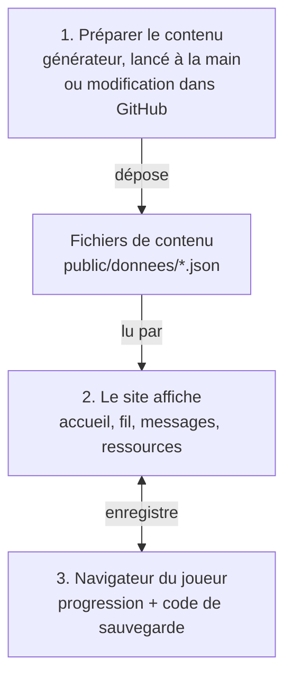

# CTRL INFO — Spécification

> Seule documentation du projet. Mise à jour : 29/10/2026.
> À modifier à chaque changement notable. L'historique est dans [JOURNAL.md](JOURNAL.md).

## 1. Le projet

Jeu web de sensibilisation à la désinformation et aux arnaques en ligne, pensé
d'abord pour la Nouvelle-Calédonie. Le joueur trie un fil façon Instagram (pour
reconnaître les pièges sur ses propres réseaux), répond à ses proches dans les
Messages et lit des fiches pour apprendre à vérifier une info.

- **Site statique** : HTML, CSS, JS, images et JSON. Pas de base de données.
- **Aucun compte, aucune donnée personnelle** : la progression reste dans le
  navigateur et s'emporte par un code à copier-coller.
- **Contenu séparé du code** : tous les textes sont dans `public/donnees/`.
- **Contenu fixe et nombreux** (160 posts, 48 sujets de Messages), fabriqué sans IA et sans relecture humaine,
  complété à l'infini dans le navigateur du joueur (« Continuer à jouer »). Les modèles
  de textes et le code ont, eux, été écrits avec l’aide d’un assistant d’IA (dit dans
  les mentions légales).
- **Projet étudiant**, édité à titre non professionnel, ni suivi ni maintenu,
  en ligne pour une durée limitée.

## 2. Stack

| Rôle | Outil |
| --- | --- |
| Interface | React 19, react-router 8, lucide-react |
| Construction | Vite 8, Node.js 24 |
| Styles | CSS maison (BEM), polices Fontsource, fond WebGL (ogl) |
| Génération du contenu | script Node + rss-parser, lancé à la main (en local ou depuis GitHub Actions) |
| Hébergement | Netlify (plan gratuit), redéployé à chaque commit sur `main` ; autre possibilité : serveur Apache + envoi SFTP/FTPS |
| Administration | `enregistrer.php`, sur serveur Apache + PHP 8.1+ seulement (absente sur Netlify) |
| Contrôles | ESLint, `verifier`, `audit:securite`, Vitest (unitaires), Playwright + axe (bout en bout et accessibilité), Dependabot |

## 3. Fonctionnalités

| Adresse | Écran | Contenu |
| --- | --- | --- |
| `/` | Accueil | stories (sites où vérifier une info), tableau d'enquête avec la vidéo du projet, brève du jour |
| `/fil` | Fil d'actualité | le jeu principal |
| `/conversations` | Messages | un fil par contact, le joueur choisit ses réponses |
| `/ressources` | Ressources | 8 thèmes, 12 sites utiles (vérifier, se protéger des arnaques, comprendre) |
| `/profil` | Profil | statistiques, avatar, code de sauvegarde, compagnon |
| `/mentions-legales` | Mentions légales | éditeur, hébergeur, données, accessibilité, propriété |

**Fil d'actualité**
- Lots de 5 posts par niveau, tirés parmi les inédits.
- Niveau 1 sans chrono, puis 60, 40, 30 et 25 s. Au-delà du niveau 5, le chrono
  raccourcit encore, sans passer sous le temps de lecture. Le chrono porte la
  courbe de difficulté (théorie du flow) : c'est une limite de temps
  essentielle au sens du RGAA (§ 9).
- Boutons « J'aime » / « Partager » (= partager) et « Signaler ». Laisser
  filer le chrono = ignorer.
- Trois sortes de faux, dans chaque niveau :
  - **les pièges des Ressources** : urgence, autorité inventée, peur, faux
    expert, chiffre sans base, fausse corrélation, photo prise ailleurs, post
    fabriqué pour le clic, satire prise au sérieux, voix truquée par IA, effet
    de halo, vérité par répétition, discours complotiste, témoignages triés…
  - **au moins 2 arnaques de 2026** : faux concours, colis bloqué (publicité),
    fausse cagnotte, offre d'emploi trop belle, placement miracle, fausse
    alerte, compte piraté qui demande un code ;
  - **un fait réel au détail changé** (2 dès le niveau 3), le piège le plus subtil.
- Vrais et faux sont publiés par les mêmes types de comptes, avec les mêmes
  voix (ado, parent, page de quiz, alarmiste…).
- Un post fait quelques phrases : d'où vient l'info, une question aux abonnés,
  la source dite comme on la dit (« je l'ai vu sur Wikipédia »), jamais « Source : ».
- Les commentaires réagissent au sujet, au lieu, à la façon d'écrire du compte ;
  sous un fait déformé, celui qui a vérifié rétablit le vrai.
- Correction : une couleur par post, rouge pour une fake news, bleu pour un
  vrai ; repères numérotés sur le compte, le titre, le texte, la date ou la photo.
- Environ un tiers d'articles : de vrais articles sous licence libre (The
  Conversation, rubriques Sciences, Environnement et Éducation ; CNIL), titre
  intact, et autant de faux de médias inventés.
- Deux erreurs sur le même procédé insèrent son post d'entraînement.
- Quand tout est vu, « Continuer à jouer » fabrique un nouveau lot dans le
  navigateur.

**Messages** : 8 contacts, 6 sujets chacun, dont une arnaque par contact
(7 arnaques : le 8e contact n'en a pas, § 10).
Chaque choix donne une réplique du personnage et une explication. Une fake
news se joue en 3 temps (ne pas transférer, chercher la source, corriger) ;
une arnaque aussi (ne pas cliquer, vérifier qui est derrière, réparer si c'est
trop tard). « Nouveau sujet » ouvre le suivant ; quand il n'y en a plus, le
navigateur en fabrique 10. Chaque contact a sa propre réserve (environ 75
sujets) ; les 7 arnaques sont communes, une seule par contact. Une pastille
signale les contacts jamais ouverts : point rouge dans la liste, nombre sur
l'onglet Messages (barre du bas et menu du haut).

**Compagnon** : un cagou en pixel art qui commente l'écran et réagit aux coups.
Il évite le texte, se range pendant une partie, se déplace à la main et se
désactive depuis le profil. Il reste immobile si le système demande de réduire
les animations.

## 4. Architecture

Le projet tient en trois étapes.

1. **Le contenu est préparé hors du site**, une fois : le générateur fabrique
   les posts à partir des faits du dépôt, les vérifie et les enregistre dans
   le dépôt ; Netlify publie alors le site. On le relance à la main au besoin,
   et on peut aussi modifier les JSON dans GitHub.
2. **Le site lit ce contenu.** Ce sont trois fichiers JSON, chargés une fois à
   l'ouverture de la page. Le site n'a pas de serveur : il ne fait qu'afficher.
3. **La progression reste chez le joueur.** Elle est gardée dans son
   navigateur. Pour changer d'appareil, il copie un code et le recolle.

Le schéma s'affiche sur GitHub ; dans VS Code, avec l'extension « Markdown
Preview Mermaid Support ».

Où se trouve chaque partie dans le code :

| Dossier / fichier | Rôle |
| --- | --- |
| `src/routes.js` | toutes les adresses |
| `src/screens/` | un fichier par écran |
| `src/components/` | coque (en-tête, onglets), jeux, compagnon |
| `src/state/` | contenu, progression, contenu fabriqué |
| `src/lib/` | tirage, niveaux, code de sauvegarde, fabrication |
| `src/css/jetons.css` | seule source des couleurs et polices |
| `src/admin/` | formulaire d'administration |
| `public/donnees/` | le contenu (JSON) |
| `public/images/` | photos libres des faits et des événements |
| `scripts/gabarits.mjs` | procédés (pièges), voix des comptes, textes de correction |
| `scripts/arnaques.mjs` | les arnaques, de la plus grossière (niveau 1) à la plus soignée (niveau 5) |
| `scripts/gabarits-conversations.mjs` | contacts et déroulés des Messages |
| `scripts/fabrique.mjs` | assemble un post, une conversation, un post d'entraînement |
| `scripts/` (autres) | génération, vérification, audit, images |
| `tests/unitaires/` | code de sauvegarde, tirage, stockage, générateur, contenu |
| `tests/e2e/` | chaque écran, les parcours, le clavier, l'accessibilité |
| `config.json` | réglages de la génération |
| `.github/workflows/` | `generation.yml` (à la main), `securite.yml` « Contrôles » (chaque envoi et chaque semaine) |

**À savoir**
- Si le contenu manque ou est cassé, l'écran affiche un message clair.
- Chaque écran a son adresse : l'hébergeur doit servir `index.html` pour toute
  adresse inconnue.
- **Stockage local** (`localStorage`, propre à chaque navigateur, jamais
  envoyé) :
  - `ctrl-info:progression` : pseudo, avatar, niveau, posts vus (5 000 au
    plus), score par procédé, réponses dans chaque conversation ; écrit à
    chaque action ;
  - `ctrl-info:generes-3` : posts et sujets de Messages fabriqués dans le
    navigateur (« Continuer à jouer », « Nouveau sujet »), 120 de chaque au
    plus, les plus anciens effacés d'abord ; relus au chargement, seules les
    fabrications locales bien formées passent ;
  - réglages du cagou (affiché, position) et écrans déjà présentés.
  Le code de sauvegarde (Profil) emporte pseudo, avatar, niveau, scores et
  résultats des conversations ; pas la liste des posts vus, ni les
  conversations en cours, ni les posts fabriqués : un autre appareil en
  fabrique d'autres. Il est compressé, limité à 10 000 caractères et relu à l'import.
- En navigation privée, le jeu marche ; la progression est perdue au
  rechargement.

## 5. Le contenu

| Où | Quoi |
| --- | --- |
| `posts-vrais.json`, `posts-faux.json` | les posts du fil (générés) |
| `contenu.json` → `faits` | faits réels et vérifiables : version vraie, version fausse (un détail changé), source, photo |
| `contenu.json` → `scenarios` | événements inventés et anodins, avec leur `lieu` (« à La Foa ») |
| `contenu.json` → `conversations` | sujets de discussion (générés) |
| `contenu.json` → `remediations` | posts d'entraînement, un par procédé (complétés seuls s'il en manque) |
| `contenu.json` → `chapitres`, `ressources`, `stories`, `astuces` | fiches, sites utiles, brèves |
| `contenu.json` → `jeux`, `niveaux`, `avatars`, `mentionsLegales` | règles, tutoriels, avatars, mentions |
| `config.json` → `generation` | posts par niveau (16), sujets par contact (6), renouvellement, médias sous licence, sujets écartés |

**Modifier un texte** : copier une entrée existante dans le JSON (attention aux
virgules), ou passer par l'administration. Puis `npm run verifier` et `npm test`.

**Ajouter un fait, pas à pas** (c'est le seul moyen de vraiment renouveler le jeu)
1. Trouver le fait sur une **source première** : gouv.nc, ISEE, Endemia,
   Météo-France NC, UNESCO… Wikipédia en dernier recours. Citer un fait
   reformulé avec un lien est libre : aucune licence n'est nécessaire.
2. Écrire `vrai`, `faux` (un seul détail changé, sans danger s'il circulait),
   `source: { nom, url }`, `theme`.
3. Photo (facultative) : sur Wikimedia Commons, domaine public, CC0, CC BY ou
   CC BY-SA, sans visage reconnaissable. L'enregistrer dans
   `public/images/faits/<id>.jpg`, lancer `npm run images` (réduit le poids et
   retire les métadonnées), puis remplir `image: { fichier, alt, auteur,
   licence, licenceUrl, page }`. Le crédit s'affiche seul dans la correction.
4. `npm run verifier && npm test`, puis `npm run generer -- --essai`.
5. Commiter sur `main` : Netlify republie tout, photo comprise. Sur serveur
   Apache, **une nouvelle photo exige un envoi complet du site** (§ 8), le
   robot n'envoyant que les JSON.

**Ajouter un procédé ou une arnaque** : copier une entrée de `CATEGORIES`
(`scripts/gabarits.mjs`) ou de `ARNAQUES` (`scripts/arnaques.mjs`), avec un
titre et une phrase par niveau. `npm test` vérifie qu'il s'applique, que ses
textes sont propres (pas de valeur vide, de tiret cadratin, de « Source : »,
de guillemets imbriqués) et le générateur lui crée son post d'entraînement.

**Règles**
- Un fait est vrai, sourcé, sans personne vivante, sans politique, coutume ni
  santé.
- Un événement inventé ne cite aucune personne, entreprise ni institution réelle.
- Un nom de compte, de page ou de média inventé ne doit pas exister : vérifier
  que son adresse n'est pas enregistrée (`nslookup nom.info` doit échouer).
- Photos : avec `alt` et crédit, affiché sous la photo dans la correction
  seulement : **jamais dans le fil ni dans les mentions légales** (celles-ci
  disent seulement que les crédits sont dans la correction). `npm run verifier` refuse une photo sans crédit.
- Jamais de média sans licence libre ; jamais de faux tiré d'un vrai article.
- Ton : on vouvoie le joueur, le cagou le tutoie, les personnages se tutoient.
  Pas de tiret cadratin. On dit « post », « fake news », « cagou ».

## 6. Génération du contenu

**Le contenu est fixe** : 16 vrais et 16 faux par niveau, 6 sujets par contact
dans les Messages, un post d'entraînement par procédé. Rien n'est programmé,
pour ne pas dépenser les crédits Netlify (plan gratuit : 300 crédits par mois,
15 par déploiement, 20 par Go servi aux joueurs ; à 0 crédit, le site est mis
en pause). Le jeu ne s'épuise pas : quand tout est vu, « Continuer à jouer » et
« Nouveau sujet » fabriquent d'autres posts dans le navigateur du joueur, avec
les mêmes modèles, sans rien demander au serveur.

**Dates** : chaque post inventé garde son âge (`ilYa`, en heures) et sa date
est recalculée le jour où l'on joue ; une information recyclée a toujours deux
ans de trop. Les vrais articles gardent leur date de publication.

**Plus d'exemples** : augmenter `postsParNiveau` ou `sujetsParContact` dans
`config.json`, puis `npm run generer -- --refaire` en local (tout est refait ;
sans `--refaire`, seuls les 2 plus anciens de chaque niveau sont remplacés).
Au-delà de 16, les mêmes faits reviennent plus souvent : **ajouter des faits
(§ 5) donne plus de variété que d'augmenter les chiffres.**

`generation.yml` fait la même chose depuis GitHub (onglet *Actions* →
« Génération du contenu » → *Run workflow*) :

1. assemble faits, événements, arnaques et articles sous licence avec les
   modèles du dépôt ;
2. remplace les posts les plus anciens de chaque niveau, en gardant autant de
   vrais que de faux, et crée les posts d'entraînement manquants ;
3. vérifie le résultat (`verifier` et `npm test`). En cas d'échec, rien n'est
   publié : le site garde la version précédente ;
4. enregistre dans le dépôt (Netlify republie : 15 crédits) ; sur serveur
   Apache, envoie aussi les 3 fichiers JSON en SFTP/FTPS.

Le générateur varie la présentation des faits : il n'invente pas
d'actualité. Seuls les articles sous licence libre apportent de la vraie
actualité.

Pour la remettre en automatique (serveur sans quota), rajouter un `schedule`
dans `generation.yml`.

**Sur Netlify, aucun secret à renseigner.** Sur serveur Apache seulement,
**secrets GitHub** (*Settings → Secrets → Actions*) :
`ENVOI_PROTOCOLE` (`sftp` ou `ftps`), `ENVOI_HOTE`, `ENVOI_UTILISATEUR`,
`ENVOI_MOT_DE_PASSE`, `ENVOI_DOSSIER`, et en SFTP `ENVOI_CLE_HOTE`
(`ssh-keyscan <hôte>`). Sans `ENVOI_HOTE`, rien n'est envoyé. Seuls les noms
figurent ici : les valeurs ne s'écrivent que dans GitHub, jamais dans un
fichier, un message ou un ticket.

## 7. Administration

Formulaire d'édition du contenu en ligne. **Sans besoin d'édition, supprimer le
dossier d'administration de `dist/`.**

- Apache + PHP uniquement. **Netlify n'exécute pas de PHP** : le build Netlify
  retire l'admin. Sur Netlify, modifier le contenu dans GitHub (fichier JSON →
  crayon → *Commit*), puis `npm run verifier` en local ou attendre les Contrôles.
- **Sans adresse choisie, pas d'admin** : le build la retire si l'adresse vaut
  `admin`, `A-CHOISIR`, ou fait moins de 12 caractères.

**Mettre l'admin en ligne**

1. Copier `config.local.json.exemple` en `config.local.json` (fichier non
   versionné, à garder sur son poste).
2. Tirer une adresse au hasard et la mettre dans `admin.chemin` :
   `node -e "console.log('gestion-' + require('crypto').randomBytes(8).toString('hex'))"`
3. Créer le `.htpasswd` **sur le serveur, hors du dossier public**, un compte
   par personne, mot de passe de 12 caractères ou plus :
   `htpasswd -B -c /chemin/absolu/.htpasswd prenom`. Mettre ce chemin dans
   `admin.htpasswd` (le chemin de l'exemple est refusé).
4. `npm run build` : le terminal confirme l'admin et le mot de passe.
   Envoyer `dist/` chez l'hébergeur.
5. L'admin s'ouvre à `https://<site>/<adresse>/`. Transmettre l'adresse
   seulement aux éditeurs, de vive voix ou par gestionnaire de mots de passe.

**Changer d'adresse** (fuite, départ d'un éditeur) : nouvelle adresse dans
`config.local.json`, `npm run build`, envoi, puis **supprimer l'ancien dossier
sur le serveur**, sinon il reste en ligne. En cas de fuite, changer aussi les
mots de passe.

Sur un serveur de build sans `config.local.json`, les variables `ADMIN_PATH`
et `ADMIN_HTPASSWD` remplacent le fichier.

**À savoir**
- Chaque enregistrement est noté dans `journal.log` (date, compte, fichier,
  résultat, IP hachée avec un sel secret `.htsel`, jamais le contenu) ; au-delà
  de 1 Mo il passe en `journal.1.log`. Les 10 dernières versions sont gardées.
- **Admin et génération s'excluent** : chaque génération écrase les
  modifications en ligne. Choisir l'un ou l'autre.

## 8. Mise en ligne

1. `npm ci && npm run lint && npm run verifier && npm run audit:securite && npm test`
2. `npm run test:e2e` (la première fois : `npx playwright install chromium`).
3. **Netlify** : relier le dépôt GitHub au site Netlify, branche de
   production `main`. Tout est dans `netlify.toml` (build, Node 24, en-têtes,
   cache, adresses des écrans) : rien à régler dans l'interface. Chaque commit
   sur `main` republie le site (15 crédits, § 6), sauf s'il ne touche que la
   doc, les tests ou les workflows (`ignore` dans `netlify.toml`) ; les autres
   branches ne coûtent rien. Regrouper les modifications avant de fusionner. Le compte Netlify, à votre nom, vaut identité d'éditeur
   donnée à l'hébergeur (LCEN, éditeur non professionnel).
   **Serveur Apache** (autre possibilité) : `npm run build`, puis copier
   `dist/` en SFTP/FTPS ; `public/.htaccess` porte les mêmes réglages.
4. Mentions légales : hébergeur Netlify rempli (adresse tirée de ses
   conditions d'utilisation ; téléphone absent de netlify.com, repris des
   annuaires d'entreprises). Si l'hébergeur change, mettre à jour la section
   « Hébergement » de `mentionsLegales` et le transfert de données.
5. Transférer le dépôt GitHub au commanditaire et lui transférer le site
   Netlify (*Team settings*), ou le recréer à son nom.
6. Vérifier : redirection HTTPS, aucune erreur « Content-Security-Policy »
   dans la console, `/fil` rechargé directement s'affiche.

**Vidéo de l'accueil** : jamais plus de 50 Mo dans `public/` (GitHub refuse
au-delà de 100 Mo, chaque lecture consomme de la bande passante). Depuis une
vidéo source : `ffmpeg -i source.mp4 -vf scale=1920:-2 -c:v libx264 -preset slow
-crf 24 -maxrate 2200k -bufsize 4400k -pix_fmt yuv420p -c:a aac -b:a 128k
-movflags +faststart -map_metadata -1 public/video/<nom>.mp4`. Les personnes
filmées doivent avoir donné leur accord écrit. Coût : la vidéo (34 Mo) ne se
télécharge qu'au clic ; une trentaine de lectures font 1 Go, soit 20 crédits
Netlify (§ 6).

## 9. Sécurité et accessibilité

**En place** : HTTPS + HSTS, en-têtes de sécurité (CSP, anti-encadrement) ;
admin protégée deux fois, limitée à 3 fichiers, protégée contre les envois
depuis un autre site et tracée ; liens externes limités à `http(s)` ; images
servies par le site seulement (`img-src 'self'`, image externe refusée par
`verifier`), donc aucune IP de joueur transmise à un tiers ; code de
sauvegarde et contenu fabriqué relus au chargement ; JSON jamais mis en cache ;
fichiers à nom unique gardés en cache un an (moins de crédits Netlify) ;
envoi en SFTP/FTPS uniquement sur Apache ; workflow « Contrôles » et Dependabot. Audit :
`npm run audit:securite` donne 49 OK, 0 alerte, 0 échec pour Netlify (admin
non construite, `config.local.json` inutile). Avec Apache, `admin.chemin` et
`admin.htpasswd` sont exigés (§ 7) : un `config.local.json` avec l'adresse
mais sans `.htpasswd` donne 1 alerte en local ; un fichier de plus de 50 Mo dans `public/`
ajoute une alerte.

**Aucun secret dans le dépôt** : chemin de l'admin, `.htpasswd` et accès
d'envoi restent dehors, et ni le build ni les workflows ne les affichent. Un
secret vu dans un commit est considéré comme volé. Aucune erreur technique
n'est montrée (erreurs PHP masquées, version du serveur cachée).

**Accessibilité** (RGAA 4.1, visé AA, non audité) : lien « Aller au contenu »,
tout se joue au clavier, zones défilantes atteignables, contrastes AA,
animations arrêtées si le système le demande, chrono annoncé aux lecteurs
d'écran au dernier tiers. Le chrono est une exception assumée (critère 13.1,
limite essentielle au jeu), décrite dans les mentions légales. `npm run
test:e2e` passe chaque écran aux règles WCAG 2.2 A et AA (axe) : un écran
qui régresse fait échouer les contrôles.

**Suivi**
- Dépôt au nom du commanditaire, double authentification, peu de collaborateurs.
- Chaque mois : *Actions* sans croix rouge, alertes Dependabot lues,
  `journal.log` sans anomalie.
- Départ d'une personne : retirer son compte (`htpasswd -D`), changer les accès
  FTP et le secret, retirer son accès au dépôt.
- Chaque année : changer les mots de passe.

| Incident | Premier geste |
| --- | --- |
| Post choquant ou fait faux | désactiver la génération, `git revert`, corriger le fait |
| Contenu modifié par un tiers | supprimer l'admin, garder les journaux, restaurer, changer tous les mots de passe |
| Secret fuité | le changer chez l'hébergeur puis sur GitHub |
| Site blanc | ouvrir `/donnees/contenu.json` ; restaurer la dernière version saine |
| Génération en échec | lire l'étape rouge dans *Actions* ; `npm test` en local donne le détail |

**Fin de vie** : désactiver les workflows, supprimer les secrets, supprimer
l'admin, archiver le dépôt. Le site statique continue seul.

## 10. Limites connues

- 57 faits et 40 événements : chaque fait sert au plus deux fois dans le
  contenu fixe, mais un joueur assidu qui « continue à jouer » les revoit.
- 44 faits sur 57 ont encore Wikipédia pour source ; les 13 autres ont une
  source première (UNESCO, ISEE, Endemia, gouv.nc, CNIL, Académie des langues
  kanak). La page de l'UNESCO
  refuse les robots et se vérifie à la main.
- Deux cas réels des Ressources ont une source en anglais (le tigre, The
  Connexion ; le riz, Oman Observer) : pas d'équivalent français trouvé qui
  confirme tout le texte.
- La fiche Endemia du cagou contient une erreur de description (« oiseau
  blanc au bec jaune ») ; les faits cités (inapte au vol, un seul œuf,
  endémique) y sont justes.
- La vidéo de l'accueil n'a ni sous-titres ni transcription (RGAA, thème 4).
- 7 arnaques pour 8 contacts : club-foot n'en a pas dans les Messages.
- Les vrais posts attendent toujours « Partager » : le jeu ne récompense pas
  encore « ne pas partager une info vraie mais non sourcée ».
- Mot de passe de l'admin sans limite d'essais.
- Les liens externes vieilliront sans entretien.

## 11. Reprendre le projet

Pour une personne qui arrive sans contexte, dans l'ordre :

1. Lire ce fichier (15 minutes), puis le haut de [JOURNAL.md](JOURNAL.md).
2. `npm ci`, `npm run dev`, jouer un niveau du fil et une conversation.
3. `npm test` et `npm run test:e2e` : tout doit être vert avant de toucher au code.
4. Ouvrir `scripts/gabarits.mjs` et `scripts/arnaques.mjs` : tout le texte des
   posts générés y est, procédé par procédé.
5. Faire une petite modification, relancer les tests, ajouter une ligne au
   JOURNAL, commiter avec un message `[Sujet] Ce qui change`.

Le dépôt frère `ctrlinfo-app` (ancienne API) n'est plus utilisé : l'archiver.
