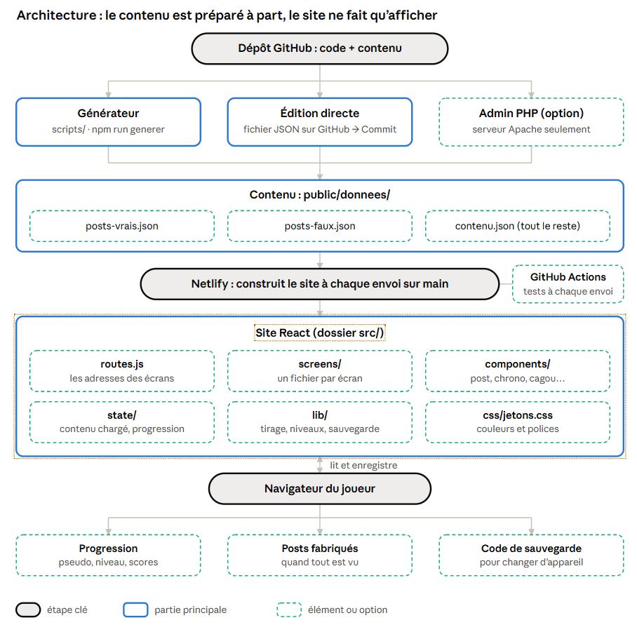
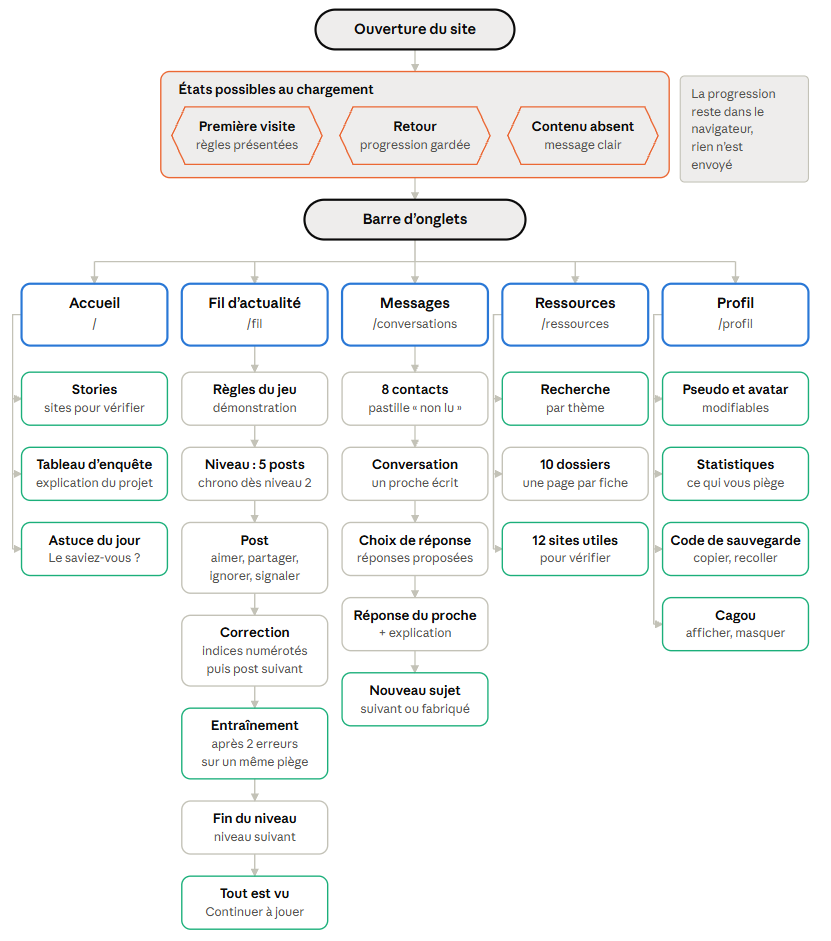
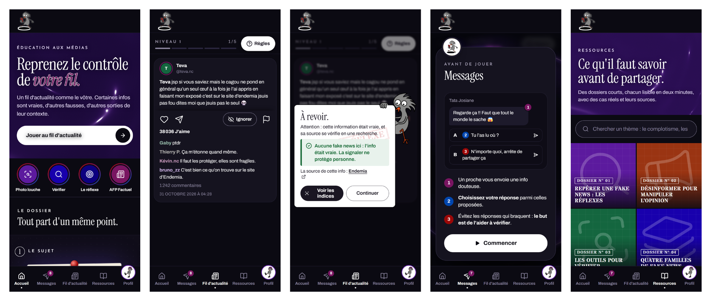

# Dossier de développement web : CTRL Info

CTRL Info est un serious game pensé pour la Nouvelle-Calédonie. Il plonge l'utilisateur, surtout les jeunes, dans une interface qu'il connaît bien et qui est aussi l'un des moyens les plus faciles et rapides de propager une fake news : les réseaux sociaux.

À travers deux jeux, le fil d'actualité et les Messages, l'utilisateur doit juger si un post est vrai ou si c'est une fake news, puis aider ses proches, dans des scénarios de conversation, à avoir les bons réflexes face à une fake news ou une arnaque. Un petit cagou l'accompagne dans ses choix, et une page Ressources présente les formes et techniques utilisées pour propager une fake news.

## 1. Liens

- Lien vers le site : https://ctrlinfo-nc.netlify.app
- Repository GitHub : https://github.com/KitsuneE24/ctrlinfo-website

## 2. Démarche du projet

L'idée : se faire piéger dans un décor familier, puis comprendre tout de suite pourquoi.

| Choix | Pourquoi |
| --- | --- |
| Interface façon Instagram | le joueur reconnaît ses réseaux ; Instagram offre tous les types de pages utiles (stories, profils, pages d'info) |
| Messagerie | en Nouvelle-Calédonie, la désinformation circule surtout sur Facebook et WhatsApp |
| Chrono de plus en plus court (aucun, puis 60 s à 25 s) | on fait défiler vite sur les réseaux ; la difficulté monte avec la maîtrise |
| Correction juste après chaque post | on apprend au moment de l'erreur, en voyant où regarder |
| Vrais et faux publiés par les mêmes comptes | l'apparence ne trahit rien : seule la vérification paie |
| Faits calédoniens, sans personne réelle | parler au public local sans blesser ni lancer de rumeur |
| Un cagou mascotte | anime le site et accompagne le joueur |

### Stack

| Élément | Outil | Pourquoi |
| --- | --- | --- |
| Interface | React 19 + react-router | composants réutilisables, une adresse par écran |
| Construction | Vite 8, Node.js 24 | rapide en développement, fichiers légers en production |
| Style | CSS écrit à la main | rendu maîtrisé ; couleurs et polices dans un seul fichier |
| Contenu | 3 fichiers JSON | modifiables sans programmer, pas de base de données |
| Posts | générateur maison (script Node, sans IA) | 160 posts et 48 sujets de Messages à partir de 49 faits sourcés |
| Progression | stockage du navigateur + code de sauvegarde | aucun compte, aucune donnée personnelle |
| Hébergement | Netlify (gratuit) | republie seul à chaque envoi sur GitHub |
| Tests | Vitest, Playwright, ESLint | jeu, contenu, accessibilité et sécurité vérifiés à chaque envoi |

### Architecture de l'application

### Arborescence du site

### Maquette des écrans (version finale, sur mobile)

## 3. Reprendre et installer

Il faut Node.js 24 et Git sur son ordinateur.

1. Récupérer le code : `git clone https://github.com/KitsuneE24/ctrlinfo-website`
2. Installer : `npm ci`
3. Lancer : `npm run dev`, puis ouvrir http://localhost:5173
4. Vérifier que tout marche : `npm test`

**Mettre en ligne** : sur Netlify, créer un site à partir du dépôt GitHub (branche `main`). Tout est déjà réglé dans `netlify.toml`. Ensuite, chaque envoi sur `main` republie le site tout seul.

**Reprendre le projet** (devenir responsable du site) :

1. Se faire transférer le dépôt GitHub (*Settings → Transfer*) ou y être ajouté comme administrateur.
2. Se faire transférer le site Netlify, ou en créer un nouveau relié au dépôt.
3. Mettre à jour l'éditeur et l'hébergeur dans les mentions légales (`contenu.json`, partie `mentionsLegales`).

## 4. Modifier le projet

**Back (le contenu)** : il n'y a pas de back-office classique. Tous les textes sont dans le dossier `public/donnees/`.

- **Sur GitHub (méthode actuelle)** : ouvrir le fichier, cliquer sur le crayon, modifier, valider. Le site se met à jour seul.
- **En local** : modifier le fichier, lancer `npm run verifier`, puis envoyer sur GitHub.
- **Renouveler les posts** : ajouter des faits dans `contenu.json`, puis lancer `npm run generer`.

**Qui peut modifier ?** Seules les personnes ajoutées au dépôt GitHub (*Settings → Collaborators*). Un inconnu peut au mieux proposer une modification, qui ne s'applique que si un membre l'accepte. Chaque modification est enregistrée avec son auteur et peut être annulée, et des contrôles automatiques bloquent un contenu cassé. Pour plus de sécurité : peu de collaborateurs, double authentification sur GitHub, et branche `main` protégée (*Settings → Branches*), pour que toute modification passe par une demande validée.

**Administration en ligne (option, non active sur Netlify)** : une page web secrète, protégée par mot de passe, qui permet de modifier les textes sans GitHub. On s'y connecte, on choisit un type de contenu (posts, faits, fiches, mentions…), on modifie, puis on clique sur *Enregistrer* : un petit script PHP réécrit le fichier sur le serveur, garde les 10 versions précédentes et note qui a modifié. Elle ne fonctionne que sur un hébergeur Apache avec PHP ; la mise en place est décrite dans `SPEC.md`, section 7. Une génération de posts écrase les modifications faites ainsi.

**Front (l'interface)** :

| Pour changer | Aller dans |
| --- | --- |
| un écran | `src/screens/` |
| un élément (post, chrono, cagou…) | `src/components/` |
| les couleurs et polices | `src/css/jetons.css` |
| les règles du jeu (niveaux, chrono) | `public/donnees/contenu.json` (partie niveaux) |

Après chaque modification : `npm test`, puis envoyer sur GitHub.

## 5. Transfert de compétences

1. Lire le fichier `SPEC.md` du dépôt (15 minutes) : toute la documentation y est.
2. Installer le projet et jouer un niveau.
3. Faire une petite modification, lancer `npm test`, puis l'envoyer.

**À savoir**

- Une virgule oubliée dans un fichier JSON casse le site ; `npm run verifier` trouve l'erreur.
- Le plan gratuit de Netlify limite le nombre de mises en ligne (environ 20 par mois) : regrouper les modifications.
- Aucun mot de passe ne doit être mis sur GitHub.
- Un fait ajouté doit être vrai, sourcé, sans personne réelle ni sujet politique ou sensible.

## 6. Équipe du projet

Le projet a été mené par une équipe d'étudiants en BUT MMI et licence professionnelle CAN (IUT de Nouvelle-Calédonie, 2026).

| Personne | Rôle dans le projet web |
| --- | --- |
| Magalie CHEN | Conception, développement et mise en ligne |
| Prune ADAM | Charte graphique, visuels (cagou et éléments graphiques) et vidéo |
| Océane LUSINCHI | Lien et validation avec le commanditaire (Haut-Commissariat) |
| Élea YUNG-HING | Contenu de la partie ressource |

Ressources pédagogiques de référence : CLEMI (centre pour l'éducation aux médias et à l'information). Les modèles de textes et le code ont été écrits avec l'aide d'un assistant d'IA, Claude IA, les mentions légales l'indiquent déjà.
