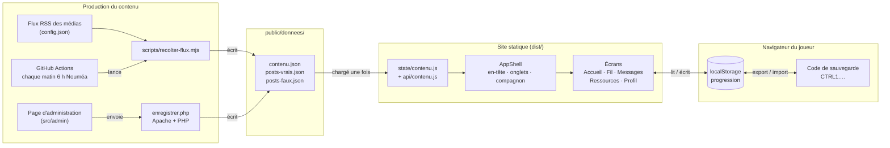

# CTRL INFO — synthèse du projet

> Dernière mise à jour : 27/10/2026 · À tenir à jour à chaque changement notable
> (voir « Journal » en bas).

## En bref

Jeu web de sensibilisation à la désinformation, pensé pour la
Nouvelle-Calédonie. Le joueur trie un fil d'actualité façon Instagram, mène des
conversations simulées et lit des fiches pour apprendre à vérifier une info.

- **Site statique** : HTML, CSS, JS, images et JSON. Pas de serveur applicatif,
  pas de base de données.
- **Aucun compte, aucune donnée personnelle** : la progression reste dans le
  navigateur du joueur et s'emporte par un code à copier-coller.
- **Contenu séparé du code** : tous les textes du jeu sont dans des fichiers
  JSON, modifiables sans toucher au code.
- **Projet étudiant remis au commanditaire**, sans maintenance prévue.

## Stack

| Rôle | Outil |
| --- | --- |
| Interface | React 19 |
| Construction | Vite 8 (Node.js 24) |
| Navigation | react-router 8 |
| Icônes | lucide-react |
| Fond animé (WebGL) | ogl |
| Polices | Fontsource (Archivo, Instrument Serif, Josefin Sans, Stardos Stencil) |
| Styles | CSS maison, classes BEM, sans framework |
| Récolte des flux | rss-parser (script Node, hors site), lancé par GitHub Actions |
| Enregistrement admin | un fichier PHP (Apache + PHP uniquement) |
| Qualité | ESLint (pas de tests automatisés) |

## Démarrer

```bash
npm ci          # installe les dépendances exactes
npm run dev     # http://localhost:5173
npm run build   # produit le site dans dist/
npm run lint    # vérifie le code
```

## Ce que voit le joueur

| Adresse | Écran | Rôle |
| --- | --- | --- |
| `/` | Accueil | bannière, stories (sites où vérifier une info), tableau d'enquête |
| `/fil` | Fil d'actu | le jeu principal : partager ou laisser filer des publications vraies/fausses, par niveaux, avec chrono |
| `/conversations` | Messages | discussions simulées : le joueur choisit ses réponses, une explication suit chaque choix |
| `/ressources` | Ressources | fiches thématiques pour comprendre les mécanismes de la désinformation |
| `/profil` | Profil | statistiques, avatar, code de sauvegarde de la progression |
| `/mentions-legales` | Mentions légales | obligations légales et politique de données |

Un **compagnon** (un cagou en pixel art) commente les écrans et réagit aux
coups ; il se déplace pour ne jamais masquer le texte. Il se désactive depuis
le profil.

## Schéma de l'architecture



## Fonctionnement

1. **Le contenu** est lu dans `public/donnees/` :
   - `posts-vrais.json` / `posts-faux.json` : les publications du fil ;
   - `contenu.json` : tout le reste (conversations, fiches, stories, astuces,
     niveaux, avatars, mentions légales…).
   Si un fichier manque ou est cassé, l'écran affiche un message d'erreur.
2. **Le fil** tire au sort des lots de 5 publications par niveau, en évitant
   celles déjà vues. Deux erreurs sur le même biais déclenchent une
   publication d'entraînement ciblée.
3. **La progression** (niveau, points, publications traitées, conversations)
   est écrite dans `localStorage` à chaque action. Le profil la convertit en un
   code (`CTRL1.…`) qu'on recolle sur un autre appareil.

## Organisation du code

```
src/
  main.jsx, App.jsx   démarrage et table des routes
  routes.js           toutes les adresses du site, en un seul endroit
  screens/            un fichier par écran (Home, Feed, Chat, Learn, Profile, Legal)
  components/         coque (en-tête, barre d'onglets), briques des jeux, compagnon
    ui/               éléments communs (gabarit de page, chargement, bannière…)
  state/              état partagé : contenu, progression, jeux, compagnon
  api/contenu.js      une fonction par type de contenu
  lib/                utilitaires (tirage, niveaux, code de sauvegarde, couleurs…)
  css/                feuilles de style ; jetons.css = couleurs et polices
  admin/              page d'administration du contenu
public/
  donnees/            le contenu du jeu (JSON)
  admin/              enregistrer.php + .htaccess (écriture du contenu)
  images, logo, sprites du compagnon
scripts/
  recolter-flux.mjs   fabrique publications et conversations depuis des flux RSS
  generer-sprite-cagou.mjs  reconstruit les planches du compagnon
docs/                 documentation détaillée
config.json           flux RSS et réglages de la récolte
```

Fichiers clés à connaître :

| Fichier | Pourquoi |
| --- | --- |
| [src/routes.js](../src/routes.js) | ajouter ou renommer une page |
| [src/state/progression.js](../src/state/progression.js) | tout ce qui est sauvegardé du joueur |
| [src/lib/codeProgression.js](../src/lib/codeProgression.js) | format du code de sauvegarde |
| [src/components/Feed.jsx](../src/components/Feed.jsx) | logique du fil d'actu |
| [src/css/jetons.css](../src/css/jetons.css) | seule source des couleurs et polices |

## Modifier le contenu

Deux façons :

- **À la main** : éditer les JSON de `public/donnees/` (attention aux virgules
  et guillemets : une erreur bloque l'affichage).
- **Par l'administration** : une page qui génère un formulaire à partir du
  contenu et l'enregistre via `enregistrer.php` (garde une copie `.bak`).
  Fonctionne seulement sur Apache + PHP, protégée par mot de passe
  (`.htaccess` / `.htpasswd`). Son adresse réelle se règle dans
  `config.local.json`, non versionné. **Sans besoin d'édition en ligne,
  supprimer le dossier d'administration de `dist/`.**

La récolte RSS (`npm run recolter`) génère de nouvelles publications et
conversations à partir des médias listés dans `config.json`, en écartant les
sujets sensibles. Elle tourne chaque matin via GitHub Actions
([recolte.yml](../.github/workflows/recolte.yml)), qui enregistre le résultat
dans le dépôt ; Netlify redéploie ensuite. Lancement manuel : bouton « Run
workflow » de l'onglet Actions.

Marche à suivre détaillée : [contenu.md](contenu.md).

## Mettre en ligne

1. `npm run build`
2. Copier le contenu de `dist/` chez l'hébergeur.
3. Faire servir `index.html` pour toute adresse inconnue : déjà réglé pour
   Apache (`.htaccess`) et Netlify (`netlify.toml`) ; pour Nginx :
   `try_files $uri $uri/ /index.html;`.
4. Avant l'ouverture : compléter les mentions légales (`mentionsLegales` dans
   `contenu.json`, champs marqués `[À compléter : …]`).

Détails : [passation.md](passation.md).

## Confidentialité et sécurité

- Rien de secret dans le dépôt : le chemin réel de l'administration et les mots
  de passe restent hors de git (`config.local.json`, `.htpasswd`).
- Aucune donnée joueur n'est envoyée à un serveur.
- Seul code exécuté côté serveur : `enregistrer.php`, s'il est conservé.

## Limites connues

- Pas de tests automatisés.
- Pas de vérification automatique du contenu : une incohérence ne se voit qu'en
  jouant.
- Les liens externes (médias, outils) vieilliront sans entretien.

## Pour aller plus loin

| Document | Contenu |
| --- | --- |
| [README.md](../README.md) | démarrage rapide |
| [architecture.md](architecture.md) | le code en détail |
| [contenu.md](contenu.md) | ajouter publications, conversations, fiches |
| [passation.md](passation.md) | mise en ligne chez le commanditaire |

## Journal

Une ligne par changement notable, le plus récent en haut.

| Date | Changement |
| --- | --- |
| 27/10/2026 | Schéma de l'architecture, récolte quotidienne |
| 27/10/2026 | Création de cette synthèse |
